# Long-range cutoff: 6 Å vs 12 Å distance scans

Two charge/spin-aware MACE models were trained from scratch on the same 20k OMol25 frames: SPICE-2 elements, |q| ≤ 2, 15 epochs, energy:force 1:1, fixed ωB97M-V atom E0s. They are identical apart from the cutoff (r_max 6 or 12 Å). Their validation energy RMSEs are 97.5 meV/atom (6 Å) and 88.3 (12 Å).

Eleven fragment pairs were pulled apart rigidly from 2.5 to 20 Å minimum gap. ORCA ωB97M-V/def2-TZVPD (RIJCOSX, def2/J, TightSCF, DEFGRID3) was run at every point, 195 single points in all.

**Method.** ΔE(d) = E(pair) − E(A) − E(B), in kcal/mol. Tables give each curve relative to its own value at 20 Å, so only the shape is compared; this removes the models' constant charge-state offset. Raw ΔE at 20 Å is quoted in the notes. Gap is the minimum atom–atom distance between the fragments.

**Result.** The 12 Å model's curves change out to about 10 Å; the 6 Å model's go flat at 5–6 Å, for every pair. The extra range gets close to the DFT shape for cation–water and cation–π. It doesn't learn the 1/r tail of ion pairs, and gets the sign wrong for the cation–cation pair. Between neutral molecules it adds spurious wells at 5–10 Å. Ion–ion behaviour likely needs explicit long-range electrostatics (e.g. MACE-POLAR), possibly with a 12 Å or longer cutoff for the cation–ligand gains.

## Summary

| Pair | Interaction | DFT 3 / 8 Å | 6 Å 3 / 8 Å | 12 Å 3 / 8 Å | 12 Å vs 6 Å |
|---|---|---|---|---|---|
| NH₄⁺ · acetate | attractive ion pair, r⁻¹ | −76.51 / −21.51 | −7.34 / +0.00 | −8.81 / −1.62 | Slight gain |
| NH₄⁺ · Cl⁻ | attractive ion pair, r⁻¹ | −74.75 / −21.22 | −2.32 / +0.00 | −1.47 / −0.19 | No gain |
| NH₄⁺ · NH₄⁺ | repulsive ion pair, r⁻¹ | +51.05 / +18.00 | −5.02 / +0.00 | −30.06 / −1.54 | 12 Å worse |
| Na⁺ · water | ion–dipole, r⁻² | −15.90 / −1.72 | −7.54 / +0.00 | −11.53 / −1.13 | 12 Å better |
| Cl⁻ · water | ion–dipole, r⁻² | −11.46 / −1.51 | −4.53 / +0.00 | −2.88 / −0.29 | No gain |
| Na⁺ · methane | ion–induced dipole, r⁻⁴ | −3.31 / −0.08 | +1.36 / +0.00 | −1.99 / −0.97 | Mixed |
| Na⁺ · benzene | cation–π and induction | −24.17 / −1.20 | −9.14 / +0.00 | −9.06 / −3.90 | 12 Å better |
| Water dimer, aligned dipoles | dipole–dipole, r⁻³ | −2.02 / −0.14 | −2.03 / +0.00 | −2.50 / −1.12 | 12 Å worse |
| Acetonitrile dimer, head to tail | dipole–dipole, r⁻³ | −3.04 / −0.34 | −3.61 / +0.00 | −10.47 / −1.60 | 12 Å worse |
| Methane dimer | dispersion, r⁻⁶ | −0.23 / −0.00 | −1.16 / +0.00 | −0.64 / −0.83 | 12 Å worse |
| Benzene dimer, stacked | dispersion and quadrupole | +11.68 / +0.01 | +10.96 / +0.00 | +1.75 / −7.29 | 12 Å worse |

## Ion–ion

### NH₄⁺ · acetate (attractive ion pair, r⁻¹): Slight gain

DFT has the long Coulomb tail: −76.5 kcal/mol at 3 Å and still −6.4 at 14 Å. Neither model follows it. The 6 Å curve is flat past 6 Å. The 12 Å curve keeps a small slope out to 10 Å and recovers about 10% of the DFT change. In raw ΔE both models put most of the attraction into a constant: −17.2 (6 Å) and −25.0 (12 Å) at 20 Å, against DFT −15.9.

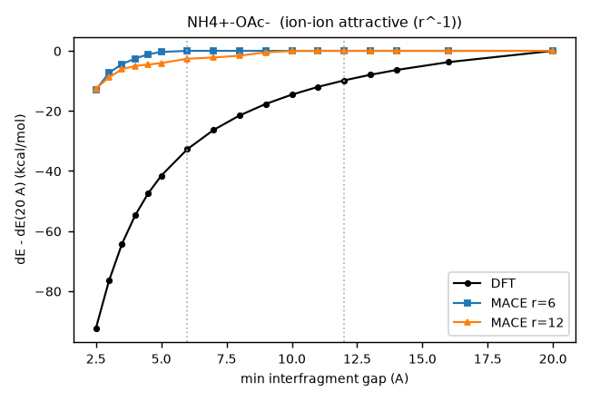

| gap (Å) | DFT | 6 Å | 12 Å | 12 Å − DFT |
|---|---|---|---|---|
| 2.50 | −92.29 | −12.98 | −12.53 | +79.76 |
| 3.00 | −76.51 | −7.34 | −8.81 | +67.70 |
| 3.50 | −64.20 | −4.39 | −6.11 | +58.09 |
| 4.00 | −54.78 | −2.56 | −5.00 | +49.79 |
| 4.50 | −47.44 | −1.16 | −4.58 | +42.86 |
| 5.00 | −41.56 | −0.37 | −4.07 | +37.49 |
| 6.00 | −32.73 | +0.00 | −2.63 | +30.10 |
| 7.00 | −26.36 | +0.00 | −2.21 | +24.15 |
| 8.00 | −21.51 | +0.00 | −1.62 | +19.89 |
| 9.00 | −17.68 | +0.00 | −0.48 | +17.20 |
| 10.00 | −14.57 | +0.00 | −0.06 | +14.51 |
| 11.00 | −12.00 | +0.00 | +0.01 | +12.01 |
| 12.00 | −9.84 | +0.00 | +0.00 | +9.84 |
| 13.00 | −7.98 | +0.00 | +0.00 | +7.98 |
| 14.00 | −6.38 | +0.00 | +0.00 | +6.38 |
| 16.00 | −3.75 | +0.00 | +0.00 | +3.75 |
| 20.00 | +0.00 | +0.00 | +0.00 | +0.00 |

### NH₄⁺ · Cl⁻ (attractive ion pair, r⁻¹): No gain

The DFT tail is the same as for the acetate pair. Both models are almost flat, with under 2% of the DFT change at any gap. Raw ΔE at 20 Å is −34.3 (6 Å) and −54.7 (12 Å), against DFT −15.8.

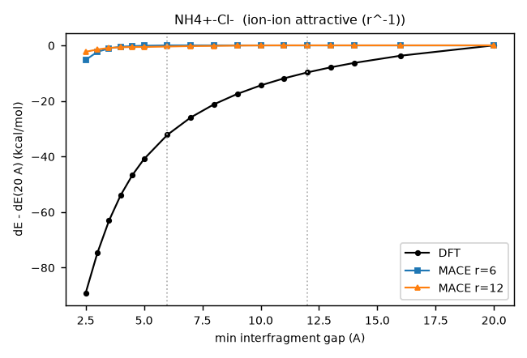

| gap (Å) | DFT | 6 Å | 12 Å | 12 Å − DFT |
|---|---|---|---|---|
| 2.50 | −89.12 | −5.22 | −2.31 | +86.81 |
| 3.00 | −74.75 | −2.32 | −1.47 | +73.27 |
| 3.50 | −63.08 | −1.08 | −0.91 | +62.17 |
| 4.00 | −53.92 | −0.49 | −0.68 | +53.24 |
| 4.50 | −46.70 | −0.27 | −0.59 | +46.12 |
| 5.00 | −40.91 | −0.12 | −0.57 | +40.34 |
| 6.00 | −32.21 | +0.00 | −0.42 | +31.79 |
| 7.00 | −25.96 | +0.00 | −0.26 | +25.70 |
| 8.00 | −21.22 | +0.00 | −0.19 | +21.03 |
| 9.00 | −17.47 | +0.00 | −0.08 | +17.40 |
| 10.00 | −14.41 | +0.00 | −0.01 | +14.40 |
| 11.00 | −11.87 | +0.00 | +0.00 | +11.88 |
| 12.00 | −9.74 | +0.00 | +0.00 | +9.74 |
| 13.00 | −7.91 | +0.00 | +0.00 | +7.91 |
| 14.00 | −6.32 | +0.00 | +0.00 | +6.32 |
| 16.00 | −3.72 | +0.00 | +0.00 | +3.72 |
| 20.00 | +0.00 | +0.00 | +0.00 | +0.00 |

### NH₄⁺ · NH₄⁺ (repulsive ion pair, r⁻¹): 12 Å worse

DFT is repulsive: +51 kcal/mol at 3 Å, decaying slowly. The 6 Å model is nearly flat. The 12 Å model has the wrong sign: about −30 at 3 Å and −12 at 6 Å, so it pulls the two cations together. Raw ΔE at 20 Å is +131 for 12 Å, against +44 for 6 Å and +15 for DFT.

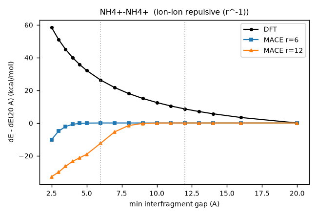

| gap (Å) | DFT | 6 Å | 12 Å | 12 Å − DFT |
|---|---|---|---|---|
| 2.50 | +58.47 | −10.17 | −32.88 | −91.35 |
| 3.00 | +51.05 | −5.02 | −30.06 | −81.11 |
| 3.50 | +45.01 | −2.19 | −26.52 | −71.53 |
| 4.00 | +39.99 | −0.81 | −23.48 | −63.47 |
| 4.50 | +35.76 | −0.26 | −21.29 | −57.05 |
| 5.00 | +32.13 | −0.07 | −19.17 | −51.30 |
| 6.00 | +26.24 | +0.00 | −12.40 | −38.64 |
| 7.00 | +21.66 | +0.00 | −5.42 | −27.08 |
| 8.00 | +18.00 | +0.00 | −1.54 | −19.54 |
| 9.00 | +15.00 | +0.00 | −0.27 | −15.27 |
| 10.00 | +12.50 | +0.00 | −0.04 | −12.54 |
| 11.00 | +10.39 | +0.00 | −0.00 | −10.39 |
| 12.00 | +8.58 | +0.00 | +0.00 | −8.58 |
| 13.00 | +7.01 | +0.00 | +0.00 | −7.01 |
| 14.00 | +5.63 | +0.00 | +0.00 | −5.63 |
| 16.00 | +3.34 | +0.00 | +0.00 | −3.34 |
| 20.00 | +0.00 | +0.00 | +0.00 | +0.00 |

## Ion–neutral

### Na⁺ · water (ion–dipole, r⁻²): 12 Å better

The 12 Å model is about twice as close to DFT as the 6 Å model at every gap out to 8 Å. At 4 Å it gives −4.8 against DFT −8.4 (6 Å gives −2.3). At 8 Å it gives −1.1 against −1.7, where the 6 Å model is already flat. Both still undershoot the well at 3 Å.

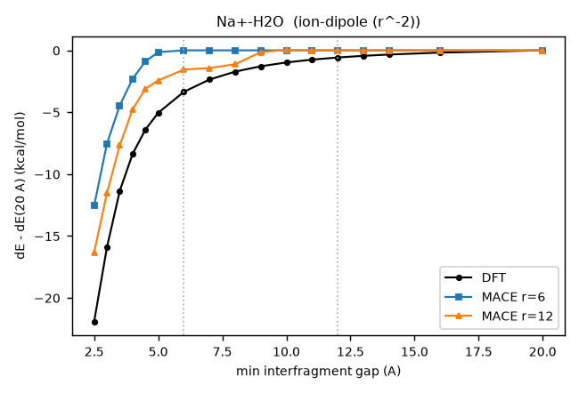

| gap (Å) | DFT | 6 Å | 12 Å | 12 Å − DFT |
|---|---|---|---|---|
| 2.50 | −21.92 | −12.55 | −16.32 | +5.60 |
| 3.00 | −15.90 | −7.54 | −11.53 | +4.38 |
| 3.50 | −11.35 | −4.45 | −7.68 | +3.68 |
| 4.00 | −8.38 | −2.30 | −4.78 | +3.60 |
| 4.50 | −6.40 | −0.89 | −3.10 | +3.30 |
| 5.00 | −5.05 | −0.14 | −2.44 | +2.61 |
| 6.00 | −3.35 | +0.00 | −1.55 | +1.80 |
| 7.00 | −2.36 | +0.00 | −1.43 | +0.93 |
| 8.00 | −1.72 | +0.00 | −1.13 | +0.60 |
| 9.00 | −1.29 | +0.00 | −0.14 | +1.14 |
| 10.00 | −0.98 | +0.00 | +0.04 | +1.02 |
| 11.00 | −0.75 | +0.00 | −0.00 | +0.75 |
| 12.00 | −0.58 | +0.00 | +0.00 | +0.58 |
| 13.00 | −0.45 | +0.00 | +0.00 | +0.45 |
| 14.00 | −0.34 | +0.00 | +0.00 | +0.34 |
| 16.00 | −0.18 | +0.00 | +0.00 | +0.18 |
| 20.00 | +0.00 | +0.00 | +0.00 | +0.00 |

### Cl⁻ · water (ion–dipole, r⁻²): No gain

Neither model follows the anion–water attraction beyond contact. The 6 Å model is slightly better at 3 Å (−4.5 against DFT −11.5). The 12 Å model is flat from 4 Å.

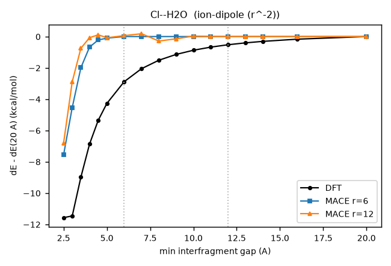

| gap (Å) | DFT | 6 Å | 12 Å | 12 Å − DFT |
|---|---|---|---|---|
| 2.50 | −11.57 | −7.56 | −6.80 | +4.77 |
| 3.00 | −11.46 | −4.53 | −2.88 | +8.58 |
| 3.50 | −8.98 | −1.99 | −0.75 | +8.23 |
| 4.00 | −6.87 | −0.67 | −0.07 | +6.80 |
| 4.50 | −5.36 | −0.22 | +0.11 | +5.47 |
| 5.00 | −4.28 | −0.10 | −0.07 | +4.20 |
| 6.00 | −2.89 | +0.00 | +0.06 | +2.94 |
| 7.00 | −2.06 | +0.00 | +0.18 | +2.24 |
| 8.00 | −1.51 | +0.00 | −0.29 | +1.23 |
| 9.00 | −1.14 | +0.00 | −0.15 | +1.00 |
| 10.00 | −0.88 | +0.00 | +0.03 | +0.91 |
| 11.00 | −0.68 | +0.00 | +0.01 | +0.68 |
| 12.00 | −0.52 | +0.00 | +0.00 | +0.52 |
| 13.00 | −0.41 | +0.00 | +0.00 | +0.41 |
| 14.00 | −0.31 | +0.00 | +0.00 | +0.31 |
| 16.00 | −0.17 | +0.00 | +0.00 | +0.17 |
| 20.00 | +0.00 | +0.00 | +0.00 | +0.00 |

### Na⁺ · methane (ion–induced dipole, r⁻⁴): Mixed

At 3 Å the 6 Å model has the wrong sign (+1.4 against DFT −3.3), and the 12 Å model is close (−2.0). From 4 to 8 Å the 12 Å model overshoots, holding about −2 kcal/mol where DFT has decayed to under −0.5.

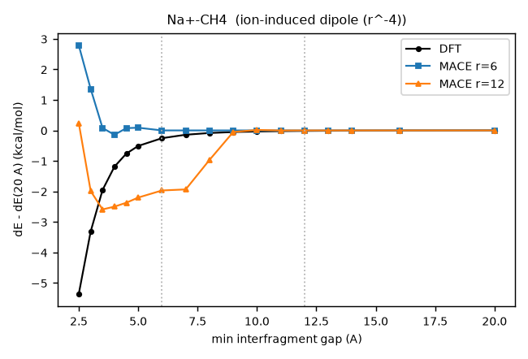

| gap (Å) | DFT | 6 Å | 12 Å | 12 Å − DFT |
|---|---|---|---|---|
| 2.50 | −5.35 | +2.78 | +0.23 | +5.58 |
| 3.00 | −3.31 | +1.36 | −1.99 | +1.32 |
| 3.50 | −1.95 | +0.08 | −2.59 | −0.64 |
| 4.00 | −1.19 | −0.14 | −2.50 | −1.31 |
| 4.50 | −0.76 | +0.07 | −2.37 | −1.61 |
| 5.00 | −0.51 | +0.09 | −2.20 | −1.69 |
| 6.00 | −0.25 | +0.00 | −1.97 | −1.71 |
| 7.00 | −0.14 | +0.00 | −1.93 | −1.79 |
| 8.00 | −0.08 | +0.00 | −0.97 | −0.88 |
| 9.00 | −0.05 | +0.00 | −0.05 | +0.00 |
| 10.00 | −0.04 | +0.00 | +0.02 | +0.05 |
| 11.00 | −0.02 | +0.00 | −0.00 | +0.02 |
| 12.00 | −0.02 | +0.00 | +0.00 | +0.02 |
| 13.00 | −0.01 | +0.00 | +0.00 | +0.01 |
| 14.00 | −0.01 | +0.00 | +0.00 | +0.01 |
| 16.00 | −0.00 | +0.00 | +0.00 | +0.00 |
| 20.00 | +0.00 | +0.00 | +0.00 | +0.00 |

### Na⁺ · benzene (cation–π and induction): 12 Å better

The clearest gain. From 4 to 6 Å the 12 Å model tracks DFT (−9.5, −6.1, −4.1 against −11.5, −5.6, −3.1), while the 6 Å model is already near zero. It overshoots at 8 Å (−3.9 against −1.2) and drops to zero by 10 Å.

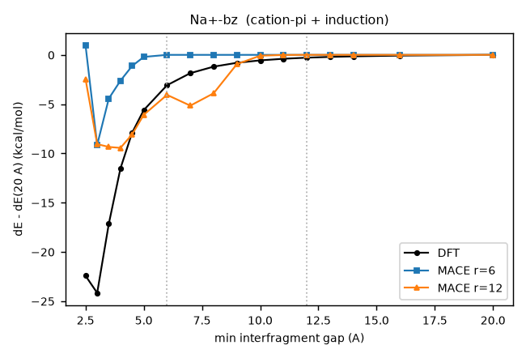

| gap (Å) | DFT | 6 Å | 12 Å | 12 Å − DFT |
|---|---|---|---|---|
| 2.50 | −22.43 | +0.96 | −2.47 | +19.96 |
| 3.00 | −24.17 | −9.14 | −9.06 | +15.11 |
| 3.50 | −17.14 | −4.43 | −9.35 | +7.79 |
| 4.00 | −11.53 | −2.62 | −9.45 | +2.08 |
| 4.50 | −7.91 | −1.13 | −8.07 | −0.17 |
| 5.00 | −5.61 | −0.21 | −6.09 | −0.48 |
| 6.00 | −3.08 | +0.00 | −4.06 | −0.98 |
| 7.00 | −1.86 | +0.00 | −5.16 | −3.30 |
| 8.00 | −1.20 | +0.00 | −3.90 | −2.71 |
| 9.00 | −0.81 | +0.00 | −0.94 | −0.13 |
| 10.00 | −0.56 | +0.00 | −0.09 | +0.47 |
| 11.00 | −0.40 | +0.00 | −0.01 | +0.39 |
| 12.00 | −0.28 | +0.00 | +0.00 | +0.28 |
| 13.00 | −0.21 | +0.00 | +0.00 | +0.21 |
| 14.00 | −0.15 | +0.00 | +0.00 | +0.15 |
| 16.00 | −0.07 | +0.00 | +0.00 | +0.07 |
| 20.00 | +0.00 | +0.00 | +0.00 | +0.00 |

## Neutral–neutral

### Water dimer, aligned dipoles (dipole–dipole, r⁻³): 12 Å worse

Both models match DFT at 3 Å. Beyond 5 Å DFT decays smoothly, to −0.14 at 8 Å. The 12 Å model holds a plateau near −1 kcal/mol out to 8 Å before dropping. The 6 Å model is flat, which is closer to DFT.

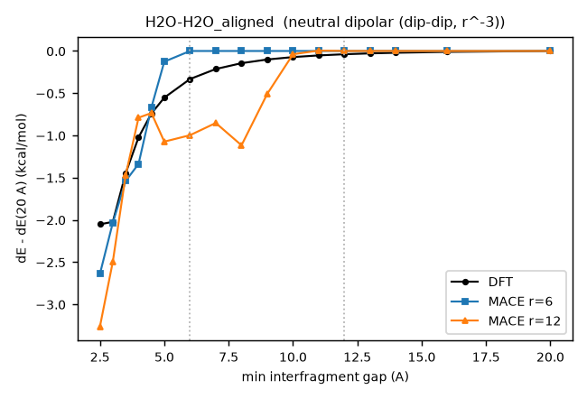

| gap (Å) | DFT | 6 Å | 12 Å | 12 Å − DFT |
|---|---|---|---|---|
| 2.50 | −2.05 | −2.64 | −3.26 | −1.21 |
| 3.00 | −2.02 | −2.03 | −2.50 | −0.47 |
| 3.50 | −1.45 | −1.54 | −1.47 | −0.02 |
| 4.00 | −1.02 | −1.34 | −0.79 | +0.23 |
| 4.50 | −0.74 | −0.67 | −0.73 | +0.01 |
| 5.00 | −0.55 | −0.13 | −1.07 | −0.52 |
| 6.00 | −0.33 | +0.00 | −1.00 | −0.67 |
| 7.00 | −0.21 | +0.00 | −0.85 | −0.64 |
| 8.00 | −0.14 | +0.00 | −1.12 | −0.97 |
| 9.00 | −0.10 | +0.00 | −0.51 | −0.41 |
| 10.00 | −0.07 | +0.00 | −0.04 | +0.03 |
| 11.00 | −0.05 | +0.00 | +0.01 | +0.06 |
| 12.00 | −0.04 | +0.00 | +0.00 | +0.04 |
| 13.00 | −0.03 | +0.00 | +0.00 | +0.03 |
| 14.00 | −0.02 | +0.00 | +0.00 | +0.02 |
| 16.00 | −0.01 | +0.00 | +0.00 | +0.01 |
| 20.00 | +0.00 | +0.00 | +0.00 | +0.00 |

### Acetonitrile dimer, head to tail (dipole–dipole, r⁻³): 12 Å worse

The 6 Å model is close to DFT at 3–4 Å. The 12 Å model is 3–5 times too attractive from 3 to 8 Å (−10.5 at 3 Å against DFT −3.0).

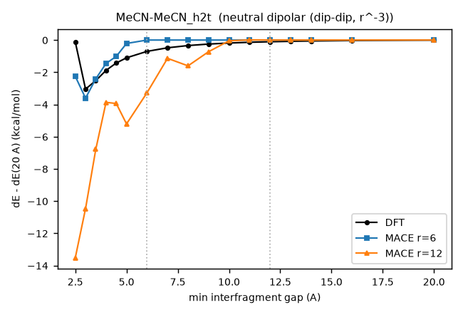

| gap (Å) | DFT | 6 Å | 12 Å | 12 Å − DFT |
|---|---|---|---|---|
| 2.50 | −0.12 | −2.25 | −13.52 | −13.39 |
| 3.00 | −3.04 | −3.61 | −10.47 | −7.42 |
| 3.50 | −2.52 | −2.41 | −6.78 | −4.26 |
| 4.00 | −1.88 | −1.45 | −3.87 | −1.98 |
| 4.50 | −1.42 | −1.01 | −3.94 | −2.52 |
| 5.00 | −1.10 | −0.21 | −5.21 | −4.11 |
| 6.00 | −0.70 | +0.00 | −3.27 | −2.57 |
| 7.00 | −0.48 | +0.00 | −1.14 | −0.65 |
| 8.00 | −0.34 | +0.00 | −1.60 | −1.26 |
| 9.00 | −0.25 | +0.00 | −0.73 | −0.48 |
| 10.00 | −0.18 | +0.00 | −0.05 | +0.14 |
| 11.00 | −0.14 | +0.00 | +0.01 | +0.15 |
| 12.00 | −0.10 | +0.00 | +0.00 | +0.10 |
| 13.00 | −0.08 | +0.00 | +0.00 | +0.08 |
| 14.00 | −0.06 | +0.00 | +0.00 | +0.06 |
| 16.00 | −0.03 | +0.00 | +0.00 | +0.03 |
| 20.00 | +0.00 | +0.00 | +0.00 | +0.00 |

### Methane dimer (dispersion, r⁻⁶): 12 Å worse

DFT is essentially zero beyond 4 Å. The 12 Å model puts in a spurious −2 kcal/mol well at 5–6 Å that fades by 10 Å. The 6 Å model is flat from 5 Å.

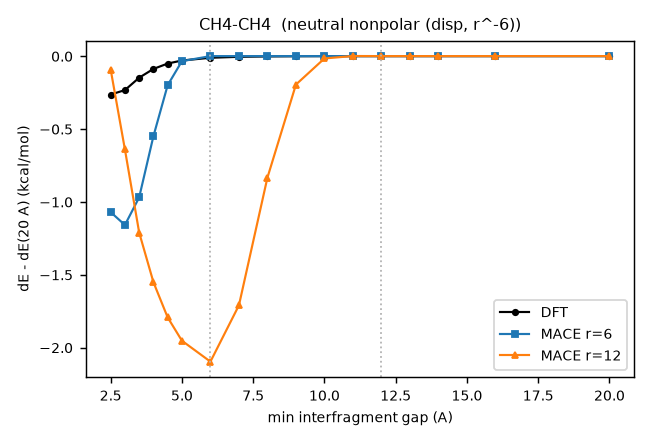

| gap (Å) | DFT | 6 Å | 12 Å | 12 Å − DFT |
|---|---|---|---|---|
| 2.50 | −0.26 | −1.07 | −0.09 | +0.17 |
| 3.00 | −0.23 | −1.16 | −0.64 | −0.41 |
| 3.50 | −0.15 | −0.97 | −1.21 | −1.06 |
| 4.00 | −0.09 | −0.55 | −1.55 | −1.46 |
| 4.50 | −0.05 | −0.20 | −1.79 | −1.74 |
| 5.00 | −0.03 | −0.04 | −1.95 | −1.92 |
| 6.00 | −0.01 | +0.00 | −2.10 | −2.09 |
| 7.00 | −0.01 | +0.00 | −1.71 | −1.71 |
| 8.00 | −0.00 | +0.00 | −0.83 | −0.83 |
| 9.00 | −0.00 | +0.00 | −0.20 | −0.19 |
| 10.00 | −0.00 | +0.00 | −0.02 | −0.02 |
| 11.00 | −0.00 | +0.00 | +0.00 | +0.00 |
| 12.00 | −0.00 | +0.00 | +0.00 | +0.00 |
| 13.00 | −0.00 | +0.00 | +0.00 | +0.00 |
| 14.00 | −0.00 | +0.00 | +0.00 | +0.00 |
| 16.00 | −0.00 | +0.00 | +0.00 | +0.00 |
| 20.00 | +0.00 | +0.00 | +0.00 | +0.00 |

### Benzene dimer, stacked (dispersion and quadrupole): 12 Å worse

The 6 Å model reproduces the 3 Å repulsion (+11.0 against DFT +11.7). The 12 Å model misses it (+1.8) and has a spurious −15 kcal/mol well at 6 Å that persists to 10 Å. This is the largest artifact in the set.

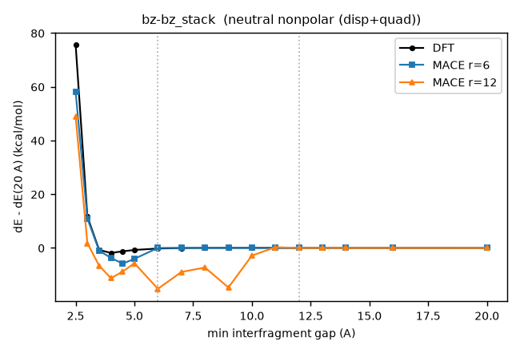

| gap (Å) | DFT | 6 Å | 12 Å | 12 Å − DFT |
|---|---|---|---|---|
| 2.50 | +75.66 | +58.09 | +48.90 | −26.76 |
| 3.00 | +11.68 | +10.96 | +1.75 | −9.93 |
| 3.50 | −0.76 | −1.02 | −6.60 | −5.84 |
| 4.00 | −1.86 | −3.69 | −11.26 | −9.40 |
| 4.50 | −1.28 | −5.85 | −8.82 | −7.54 |
| 5.00 | −0.77 | −4.07 | −5.71 | −4.94 |
| 6.00 | −0.23 | +0.00 | −15.23 | −15.01 |
| 7.00 | −0.05 | +0.00 | −8.96 | −8.92 |
| 8.00 | +0.01 | +0.00 | −7.29 | −7.30 |
| 9.00 | +0.02 | +0.00 | −14.73 | −14.75 |
| 10.00 | +0.02 | +0.00 | −2.86 | −2.88 |
| 11.00 | +0.02 | +0.00 | +0.25 | +0.23 |
| 12.00 | +0.01 | +0.00 | +0.00 | −0.01 |
| 13.00 | +0.01 | +0.00 | +0.00 | −0.01 |
| 14.00 | +0.01 | +0.00 | +0.00 | −0.01 |
| 16.00 | +0.00 | +0.00 | +0.00 | −0.00 |
| 20.00 | +0.00 | +0.00 | +0.00 | +0.00 |

Data: `longrange/scan/results/scan_table.tsv` (raw and shifted, all points); ORCA outputs in `longrange/scan/orca/`.
