# Long-range cutoff: 6 Å vs 12 Å distance scans (30 epochs)

This is the 30-epoch version of `SCAN_NOTES.md`, which covers the same models after 15 epochs. Two charge/spin-aware MACE models were trained from scratch on the same 20k OMol25 frames: SPICE-2 elements, |q| ≤ 2, energy:force 1:1, fixed ωB97M-V atom E0s. They are identical apart from the cutoff (r_max 6 or 12 Å). Each was trained for 15 epochs and then continued for 15 more at the same learning rate (1e-3) as `omol_spice20k_r{6,12}_ep30`. Their validation energy RMSEs are 85.6 meV/atom (6 Å) and 75.2 (12 Å), down from 97.5 and 88.3 at 15 epochs. Force RMSEs are 226.5 and 226.0 meV/Å, down from 251.7 and 257.7.

The scans are the ones in `SCAN_NOTES.md`. Eleven fragment pairs were pulled apart rigidly from 2.5 to 20 Å minimum gap. ORCA ωB97M-V/def2-TZVPD (RIJCOSX, def2/J, TightSCF, DEFGRID3) was run at every point, 195 single points in all.

**Method.** ΔE(d) = E(pair) − E(A) − E(B), in kcal/mol. Tables give each curve relative to its own value at 20 Å, so only the shape is compared; this removes the models' constant charge-state offset. Raw ΔE at 20 Å is quoted in the notes. Gap is the minimum atom–atom distance between the fragments.

**Result.** The picture from 15 epochs holds. The 12 Å model's curves change out to about 10 Å; the 6 Å model's go flat at 5–6 Å, for every pair. The extra training mostly improved the contact region (3–4 Å): cation–water and cation–π at 12 Å are now close to DFT there, and both models are better for anion–water. It did not teach either model the 1/r tail of ion pairs. The 12 Å model's wrong-sign attraction between the two cations got larger. Its spurious wells between neutral molecules got smaller for water, acetonitrile and methane but not for the stacked benzene dimer. Ion–ion behaviour likely still needs explicit long-range electrostatics (e.g. MACE-POLAR).

## Summary

| Pair | Interaction | DFT 3 / 8 Å | 6 Å 3 / 8 Å | 12 Å 3 / 8 Å | 12 Å vs 6 Å |
|---|---|---|---|---|---|
| NH₄⁺ · acetate | attractive ion pair, r⁻¹ | −76.51 / −21.51 | −10.17 / +0.00 | −12.57 / −1.52 | Slight gain |
| NH₄⁺ · Cl⁻ | attractive ion pair, r⁻¹ | −74.75 / −21.22 | −5.42 / +0.00 | −5.88 / −0.36 | No gain |
| NH₄⁺ · NH₄⁺ | repulsive ion pair, r⁻¹ | +51.05 / +18.00 | −3.67 / +0.00 | −42.71 / −2.71 | 12 Å worse |
| Na⁺ · water | ion–dipole, r⁻² | −15.90 / −1.72 | −12.32 / +0.00 | −15.52 / −1.69 | 12 Å better |
| Cl⁻ · water | ion–dipole, r⁻² | −11.46 / −1.51 | −8.03 / +0.00 | −4.88 / −0.25 | 6 Å better |
| Na⁺ · methane | ion–induced dipole, r⁻⁴ | −3.31 / −0.08 | +1.67 / +0.00 | −2.57 / −1.33 | Mixed |
| Na⁺ · benzene | cation–π and induction | −24.17 / −1.20 | −12.29 / +0.00 | −14.61 / −5.44 | 12 Å better close in, overshoots |
| Water dimer, aligned dipoles | dipole–dipole, r⁻³ | −2.02 / −0.14 | −2.26 / +0.00 | −2.42 / −0.82 | 12 Å slightly worse |
| Acetonitrile dimer, head to tail | dipole–dipole, r⁻³ | −3.04 / −0.34 | −3.10 / +0.00 | −7.92 / −1.45 | 12 Å worse |
| Methane dimer | dispersion, r⁻⁶ | −0.23 / −0.00 | −0.66 / +0.00 | +0.66 / −0.66 | 12 Å worse |
| Benzene dimer, stacked | dispersion and quadrupole | +11.68 / +0.01 | +13.70 / +0.00 | +5.32 / −4.71 | 12 Å worse |

## 15 vs 30 epochs

Shifted ΔE in kcal/mol, 15 → 30 epochs. DFT is unchanged.

| Pair | DFT 3 / 8 Å | 6 Å at 3 Å | 12 Å at 3 Å | 12 Å at 8 Å | Raw ΔE at 20 Å, 6 Å | Raw ΔE at 20 Å, 12 Å | DFT raw at 20 Å |
|---|---|---|---|---|---|---|---|
| NH₄⁺ · acetate | −76.51 / −21.51 | −7.34 → −10.17 | −8.81 → −12.57 | −1.62 → −1.52 | −17.2 → −19.2 | −25.0 → −27.5 | −15.9 |
| NH₄⁺ · Cl⁻ | −74.75 / −21.22 | −2.32 → −5.42 | −1.47 → −5.88 | −0.19 → −0.36 | −34.3 → −31.4 | −54.7 → −57.1 | −15.8 |
| NH₄⁺ · NH₄⁺ | +51.05 / +18.00 | −5.02 → −3.67 | −30.06 → −42.71 | −1.54 → −2.71 | +44.3 → +16.6 | +131.5 → +125.5 | +15.1 |
| Na⁺ · water | −15.90 / −1.72 | −7.54 → −12.32 | −11.53 → −15.52 | −1.13 → −1.69 | +15.7 → +17.7 | +32.8 → +39.9 | −0.3 |
| Cl⁻ · water | −11.46 / −1.51 | −4.53 → −8.03 | −2.88 → −4.88 | −0.29 → −0.25 | −4.8 → −3.9 | −11.3 → −12.0 | −0.3 |
| Na⁺ · methane | −3.31 / −0.08 | +1.36 → +1.67 | −1.99 → −2.57 | −0.97 → −1.33 | +18.0 → +18.6 | +37.2 → +46.2 | −0.0 |
| Na⁺ · benzene | −24.17 / −1.20 | −9.14 → −12.29 | −9.06 → −14.61 | −3.90 → −5.44 | +29.7 → +36.5 | +62.4 → +77.9 | −0.1 |
| Water dimer | −2.02 / −0.14 | −2.03 → −2.26 | −2.50 → −2.42 | −1.12 → −0.82 | 0.0 → 0.0 | 0.0 → 0.0 | 0.0 |
| Acetonitrile dimer | −3.04 / −0.34 | −3.61 → −3.10 | −10.47 → −7.92 | −1.60 → −1.45 | 0.0 → 0.0 | 0.0 → 0.0 | 0.0 |
| Methane dimer | −0.23 / −0.00 | −1.16 → −0.66 | −0.64 → +0.66 | −0.83 → −0.66 | 0.0 → 0.0 | 0.0 → 0.0 | 0.0 |
| Benzene dimer | +11.68 / +0.01 | +10.96 → +13.70 | +1.75 → +5.32 | −7.29 → −4.71 | 0.0 → 0.0 | 0.0 → 0.0 | 0.0 |

- **Contact region improved.** At 3 Å, Na⁺ · water at 12 Å went from −11.5 to −15.5, against DFT −15.9. Na⁺ · benzene at 12 Å went from −9.1 to −14.6, against −24.2. Cl⁻ · water improved for both models. The ion pairs became slightly more attractive at contact for both models, but are still around 10% of DFT.
- **Range unchanged.** Every 12 Å curve is still flat beyond 10–11 Å, and every 6 Å curve beyond 5–6 Å. Neither model has picked up any of the ion-pair 1/r tail past its cutoff.
- **Mixed on the 12 Å artifacts.** The spurious attraction between neutral molecules shrank for acetonitrile (−10.5 → −7.9 at 3 Å), water and methane at 8 Å, and benzene at 8 Å. It grew for the two cations (−30 → −43 at 3 Å) and for Na⁺ · methane and Na⁺ · benzene at 8 Å. The benzene dimer gained a new −12.5 kcal/mol dip at 9 Å.
- **Constant offsets.** The 6 Å model's raw ΔE at 20 Å for NH₄⁺ · NH₄⁺ came down from +44 to +16.6, close to DFT (+15.1). The 12 Å model's offsets for Na⁺ pairs grew (e.g. Na⁺ · benzene +62 → +78). These cancel in the shifted curves but matter for absolute energies of separated charged fragments.

## Ion–ion

### NH₄⁺ · acetate (attractive ion pair, r⁻¹): Slight gain

DFT has the long Coulomb tail: −76.5 kcal/mol at 3 Å and still −6.4 at 14 Å. Neither model follows it. The 6 Å curve is flat past 6 Å. The 12 Å curve keeps a small slope out to 9 Å and recovers 7–16% of the DFT change, as at 15 epochs. In raw ΔE both models put most of the attraction into a constant: −19.2 (6 Å) and −27.5 (12 Å) at 20 Å, against DFT −15.9.

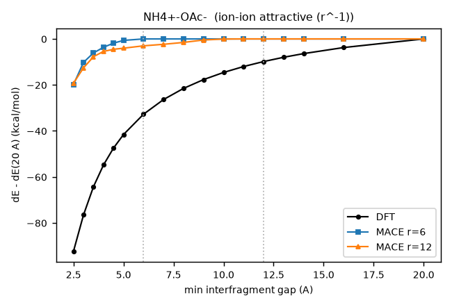

| gap (Å) | DFT | 6 Å | 12 Å | 12 Å − DFT |
|---|---|---|---|---|
| 2.50 | −92.29 | −19.81 | −19.24 | +73.05 |
| 3.00 | −76.51 | −10.17 | −12.57 | +63.94 |
| 3.50 | −64.20 | −6.09 | −7.71 | +56.49 |
| 4.00 | −54.78 | −3.63 | −5.43 | +49.35 |
| 4.50 | −47.44 | −1.83 | −4.51 | +42.93 |
| 5.00 | −41.56 | −0.63 | −4.03 | +37.54 |
| 6.00 | −32.73 | +0.00 | −3.00 | +29.73 |
| 7.00 | −26.36 | +0.00 | −2.34 | +24.02 |
| 8.00 | −21.51 | +0.00 | −1.52 | +19.99 |
| 9.00 | −17.68 | +0.00 | −0.46 | +17.22 |
| 10.00 | −14.57 | +0.00 | −0.06 | +14.52 |
| 11.00 | −12.00 | +0.00 | +0.01 | +12.01 |
| 12.00 | −9.84 | +0.00 | +0.00 | +9.84 |
| 13.00 | −7.98 | +0.00 | +0.00 | +7.98 |
| 14.00 | −6.38 | +0.00 | +0.00 | +6.38 |
| 16.00 | −3.75 | +0.00 | +0.00 | +3.75 |
| 20.00 | +0.00 | +0.00 | +0.00 | +0.00 |

### NH₄⁺ · Cl⁻ (attractive ion pair, r⁻¹): No gain

The DFT tail is the same as for the acetate pair. Both models now give about −5.5 at 3 Å (DFT −74.7) and are flat beyond, the 12 Å model with under 5% of the DFT change past 4 Å. Raw ΔE at 20 Å is −31.4 (6 Å) and −57.1 (12 Å), against DFT −15.8.

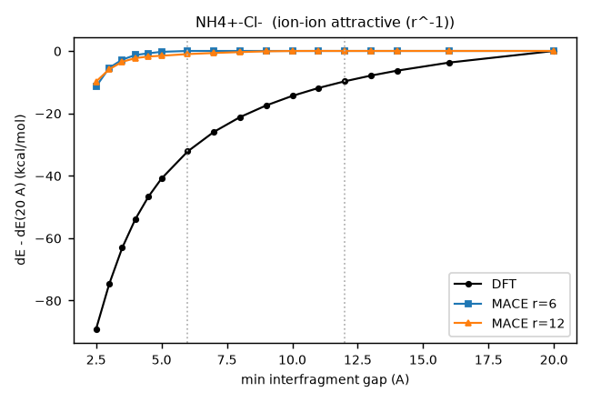

| gap (Å) | DFT | 6 Å | 12 Å | 12 Å − DFT |
|---|---|---|---|---|
| 2.50 | −89.12 | −11.37 | −9.80 | +79.32 |
| 3.00 | −74.75 | −5.42 | −5.88 | +68.86 |
| 3.50 | −63.08 | −2.77 | −3.48 | +59.60 |
| 4.00 | −53.92 | −1.31 | −2.30 | +51.63 |
| 4.50 | −46.70 | −0.74 | −1.78 | +44.92 |
| 5.00 | −40.91 | −0.28 | −1.54 | +39.38 |
| 6.00 | −32.21 | +0.00 | −1.00 | +31.21 |
| 7.00 | −25.96 | +0.00 | −0.65 | +25.31 |
| 8.00 | −21.22 | +0.00 | −0.36 | +20.86 |
| 9.00 | −17.47 | +0.00 | −0.12 | +17.36 |
| 10.00 | −14.41 | +0.00 | −0.01 | +14.40 |
| 11.00 | −11.87 | +0.00 | +0.00 | +11.88 |
| 12.00 | −9.74 | +0.00 | +0.00 | +9.74 |
| 13.00 | −7.91 | +0.00 | +0.00 | +7.91 |
| 14.00 | −6.32 | +0.00 | +0.00 | +6.32 |
| 16.00 | −3.72 | +0.00 | +0.00 | +3.72 |
| 20.00 | +0.00 | +0.00 | +0.00 | +0.00 |

### NH₄⁺ · NH₄⁺ (repulsive ion pair, r⁻¹): 12 Å worse

DFT is repulsive: +51 kcal/mol at 3 Å, decaying slowly. The 6 Å model is nearly flat. The 12 Å model has the wrong sign, and more so than at 15 epochs: −42.7 at 3 Å (was −30) and −21.5 at 6 Å, so it pulls the two cations together. Raw ΔE at 20 Å is +125.5 for 12 Å, against +16.6 for 6 Å and +15.1 for DFT.

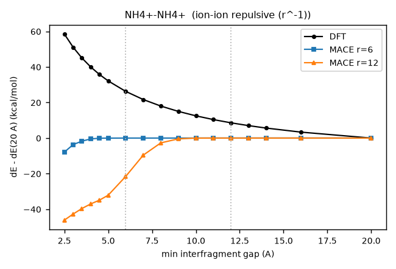

| gap (Å) | DFT | 6 Å | 12 Å | 12 Å − DFT |
|---|---|---|---|---|
| 2.50 | +58.47 | −7.87 | −46.13 | −104.60 |
| 3.00 | +51.05 | −3.67 | −42.71 | −93.76 |
| 3.50 | +45.01 | −1.73 | −39.60 | −84.62 |
| 4.00 | +39.99 | −0.49 | −37.05 | −77.04 |
| 4.50 | +35.76 | −0.07 | −34.91 | −70.67 |
| 5.00 | +32.13 | −0.03 | −32.12 | −64.25 |
| 6.00 | +26.24 | +0.00 | −21.54 | −47.78 |
| 7.00 | +21.66 | +0.00 | −9.58 | −31.24 |
| 8.00 | +18.00 | +0.00 | −2.71 | −20.71 |
| 9.00 | +15.00 | +0.00 | −0.44 | −15.44 |
| 10.00 | +12.50 | +0.00 | −0.03 | −12.54 |
| 11.00 | +10.39 | +0.00 | −0.00 | −10.39 |
| 12.00 | +8.58 | +0.00 | +0.00 | −8.58 |
| 13.00 | +7.01 | +0.00 | +0.00 | −7.01 |
| 14.00 | +5.63 | +0.00 | +0.00 | −5.63 |
| 16.00 | +3.34 | +0.00 | +0.00 | −3.34 |
| 20.00 | +0.00 | +0.00 | +0.00 | +0.00 |

## Ion–neutral

### Na⁺ · water (ion–dipole, r⁻²): 12 Å better

The best result in the set. The 12 Å model is now within 1.2 kcal/mol of DFT at every gap out to 8 Å and recovers 83–98% of the DFT change (−15.5 against −15.9 at 3 Å, −1.7 against −1.7 at 8 Å). It drops to zero by 10 Å, where DFT is still −1.0. The 6 Å model also improved at contact (−12.3 at 3 Å) but is flat from 6 Å.

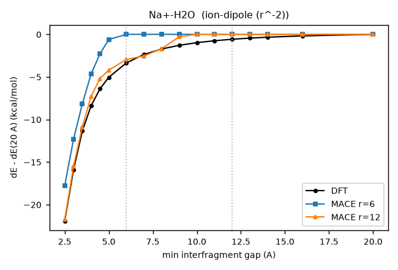

| gap (Å) | DFT | 6 Å | 12 Å | 12 Å − DFT |
|---|---|---|---|---|
| 2.50 | −21.92 | −17.76 | −21.73 | +0.19 |
| 3.00 | −15.90 | −12.32 | −15.52 | +0.39 |
| 3.50 | −11.35 | −8.16 | −10.86 | +0.49 |
| 4.00 | −8.38 | −4.65 | −7.28 | +1.09 |
| 4.50 | −6.40 | −2.29 | −5.19 | +1.21 |
| 5.00 | −5.05 | −0.61 | −4.20 | +0.85 |
| 6.00 | −3.35 | +0.00 | −2.95 | +0.40 |
| 7.00 | −2.36 | +0.00 | −2.54 | −0.18 |
| 8.00 | −1.72 | +0.00 | −1.69 | +0.03 |
| 9.00 | −1.29 | +0.00 | −0.29 | +1.00 |
| 10.00 | −0.98 | +0.00 | +0.01 | +0.99 |
| 11.00 | −0.75 | +0.00 | −0.01 | +0.75 |
| 12.00 | −0.58 | +0.00 | +0.00 | +0.58 |
| 13.00 | −0.45 | +0.00 | +0.00 | +0.45 |
| 14.00 | −0.34 | +0.00 | +0.00 | +0.34 |
| 16.00 | −0.18 | +0.00 | +0.00 | +0.18 |
| 20.00 | +0.00 | +0.00 | +0.00 | +0.00 |

### Cl⁻ · water (ion–dipole, r⁻²): 6 Å better

Neither model follows the anion–water attraction beyond contact. Both improved at 3 Å, the 6 Å model more (−8.0 against DFT −11.5; 12 Å gives −4.9). Both are within 0.5 kcal/mol of zero from 5 Å, where DFT is still −4.3.

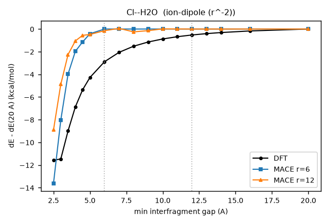

| gap (Å) | DFT | 6 Å | 12 Å | 12 Å − DFT |
|---|---|---|---|---|
| 2.50 | −11.57 | −13.61 | −8.90 | +2.68 |
| 3.00 | −11.46 | −8.03 | −4.88 | +6.59 |
| 3.50 | −8.98 | −3.97 | −2.25 | +6.73 |
| 4.00 | −6.87 | −1.96 | −1.05 | +5.82 |
| 4.50 | −5.36 | −1.14 | −0.56 | +4.80 |
| 5.00 | −4.28 | −0.42 | −0.48 | +3.80 |
| 6.00 | −2.89 | +0.00 | −0.14 | +2.74 |
| 7.00 | −2.06 | +0.00 | +0.06 | +2.11 |
| 8.00 | −1.51 | +0.00 | −0.25 | +1.27 |
| 9.00 | −1.14 | +0.00 | −0.14 | +1.00 |
| 10.00 | −0.88 | +0.00 | +0.02 | +0.89 |
| 11.00 | −0.68 | +0.00 | +0.01 | +0.68 |
| 12.00 | −0.52 | +0.00 | +0.00 | +0.52 |
| 13.00 | −0.41 | +0.00 | +0.00 | +0.41 |
| 14.00 | −0.31 | +0.00 | +0.00 | +0.31 |
| 16.00 | −0.17 | +0.00 | +0.00 | +0.17 |
| 20.00 | +0.00 | +0.00 | +0.00 | +0.00 |

### Na⁺ · methane (ion–induced dipole, r⁻⁴): Mixed

At 3 Å the 6 Å model still has the wrong sign (+1.7 against DFT −3.3), and the 12 Å model is close (−2.6). From 4 to 7 Å the 12 Å model holds a plateau near −2.6 kcal/mol where DFT has decayed to under −1.2 and then to −0.1. This overshoot is slightly larger than at 15 epochs.

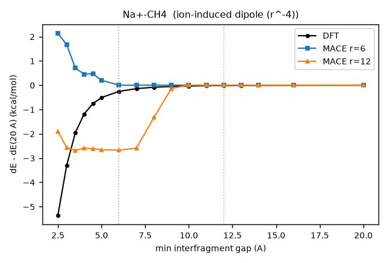

| gap (Å) | DFT | 6 Å | 12 Å | 12 Å − DFT |
|---|---|---|---|---|
| 2.50 | −5.35 | +2.13 | −1.90 | +3.46 |
| 3.00 | −3.31 | +1.67 | −2.57 | +0.74 |
| 3.50 | −1.95 | +0.70 | −2.68 | −0.73 |
| 4.00 | −1.19 | +0.46 | −2.59 | −1.40 |
| 4.50 | −0.76 | +0.47 | −2.62 | −1.86 |
| 5.00 | −0.51 | +0.20 | −2.66 | −2.15 |
| 6.00 | −0.25 | +0.00 | −2.67 | −2.42 |
| 7.00 | −0.14 | +0.00 | −2.59 | −2.45 |
| 8.00 | −0.08 | +0.00 | −1.33 | −1.24 |
| 9.00 | −0.05 | +0.00 | −0.14 | −0.08 |
| 10.00 | −0.04 | +0.00 | +0.01 | +0.04 |
| 11.00 | −0.02 | +0.00 | −0.00 | +0.02 |
| 12.00 | −0.02 | +0.00 | +0.00 | +0.02 |
| 13.00 | −0.01 | +0.00 | +0.00 | +0.01 |
| 14.00 | −0.01 | +0.00 | +0.00 | +0.01 |
| 16.00 | −0.00 | +0.00 | +0.00 | +0.00 |
| 20.00 | +0.00 | +0.00 | +0.00 | +0.00 |

### Na⁺ · benzene (cation–π and induction): 12 Å better close in, overshoots

The 12 Å model is now right at 4 Å (−12.3 against DFT −11.5) and much improved at 3 Å (−14.6 against −24.2; was −9.1). Beyond 5 Å it overshoots more than before: −6.6, −7.7 and −5.4 at 6, 7 and 8 Å, against DFT −3.1, −1.9 and −1.2. It drops to zero by 10 Å. The 6 Å model is near zero from 5 Å.

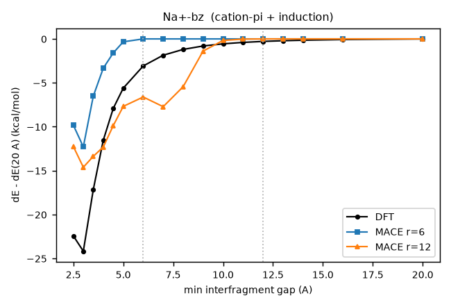

| gap (Å) | DFT | 6 Å | 12 Å | 12 Å − DFT |
|---|---|---|---|---|
| 2.50 | −22.43 | −9.82 | −12.25 | +10.18 |
| 3.00 | −24.17 | −12.29 | −14.61 | +9.56 |
| 3.50 | −17.14 | −6.51 | −13.37 | +3.78 |
| 4.00 | −11.53 | −3.33 | −12.31 | −0.78 |
| 4.50 | −7.91 | −1.59 | −9.87 | −1.96 |
| 5.00 | −5.61 | −0.33 | −7.68 | −2.07 |
| 6.00 | −3.08 | +0.00 | −6.61 | −3.53 |
| 7.00 | −1.86 | +0.00 | −7.71 | −5.86 |
| 8.00 | −1.20 | +0.00 | −5.44 | −4.25 |
| 9.00 | −0.81 | +0.00 | −1.38 | −0.58 |
| 10.00 | −0.56 | +0.00 | −0.18 | +0.38 |
| 11.00 | −0.40 | +0.00 | −0.02 | +0.37 |
| 12.00 | −0.28 | +0.00 | +0.00 | +0.28 |
| 13.00 | −0.21 | +0.00 | +0.00 | +0.21 |
| 14.00 | −0.15 | +0.00 | +0.00 | +0.15 |
| 16.00 | −0.07 | +0.00 | +0.00 | +0.07 |
| 20.00 | +0.00 | +0.00 | +0.00 | +0.00 |

## Neutral–neutral

### Water dimer, aligned dipoles (dipole–dipole, r⁻³): 12 Å slightly worse

Both models match DFT at 3 Å. Beyond 5 Å DFT decays smoothly, to −0.14 at 8 Å. The 12 Å model holds about −0.5 to −0.8 out to 8 Å before dropping; the plateau is smaller than at 15 epochs (−1.1 at 8 Å). The 6 Å model is flat from 6 Å, which is closer to DFT.

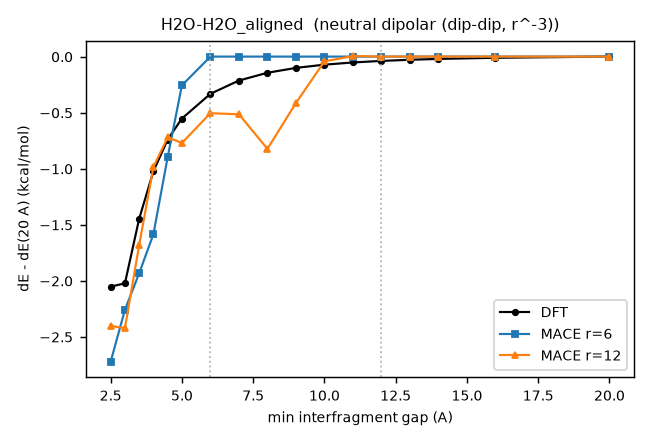

| gap (Å) | DFT | 6 Å | 12 Å | 12 Å − DFT |
|---|---|---|---|---|
| 2.50 | −2.05 | −2.72 | −2.40 | −0.35 |
| 3.00 | −2.02 | −2.26 | −2.42 | −0.40 |
| 3.50 | −1.45 | −1.93 | −1.68 | −0.23 |
| 4.00 | −1.02 | −1.58 | −0.98 | +0.04 |
| 4.50 | −0.74 | −0.90 | −0.72 | +0.02 |
| 5.00 | −0.55 | −0.26 | −0.77 | −0.22 |
| 6.00 | −0.33 | +0.00 | −0.51 | −0.17 |
| 7.00 | −0.21 | +0.00 | −0.52 | −0.30 |
| 8.00 | −0.14 | +0.00 | −0.82 | −0.68 |
| 9.00 | −0.10 | +0.00 | −0.41 | −0.31 |
| 10.00 | −0.07 | +0.00 | −0.04 | +0.03 |
| 11.00 | −0.05 | +0.00 | +0.01 | +0.06 |
| 12.00 | −0.04 | +0.00 | +0.00 | +0.04 |
| 13.00 | −0.03 | +0.00 | +0.00 | +0.03 |
| 14.00 | −0.02 | +0.00 | +0.00 | +0.02 |
| 16.00 | −0.01 | +0.00 | +0.00 | +0.01 |
| 20.00 | +0.00 | +0.00 | +0.00 | +0.00 |

### Acetonitrile dimer, head to tail (dipole–dipole, r⁻³): 12 Å worse

The 6 Å model matches DFT at 3 Å (−3.1 against −3.0). The 12 Å model is still 2.5–5 times too attractive from 3 to 8 Å (−7.9 at 3 Å, down from −10.5 at 15 epochs).

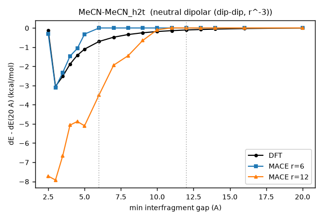

| gap (Å) | DFT | 6 Å | 12 Å | 12 Å − DFT |
|---|---|---|---|---|
| 2.50 | −0.12 | −0.29 | −7.72 | −7.60 |
| 3.00 | −3.04 | −3.10 | −7.92 | −4.88 |
| 3.50 | −2.52 | −2.32 | −6.66 | −4.14 |
| 4.00 | −1.88 | −1.47 | −5.07 | −3.18 |
| 4.50 | −1.42 | −1.07 | −4.88 | −3.45 |
| 5.00 | −1.10 | −0.32 | −5.10 | −4.00 |
| 6.00 | −0.70 | +0.00 | −3.49 | −2.79 |
| 7.00 | −0.48 | +0.00 | −1.94 | −1.46 |
| 8.00 | −0.34 | +0.00 | −1.45 | −1.10 |
| 9.00 | −0.25 | +0.00 | −0.65 | −0.41 |
| 10.00 | −0.18 | +0.00 | −0.09 | +0.09 |
| 11.00 | −0.14 | +0.00 | +0.01 | +0.14 |
| 12.00 | −0.10 | +0.00 | +0.00 | +0.10 |
| 13.00 | −0.08 | +0.00 | +0.00 | +0.08 |
| 14.00 | −0.06 | +0.00 | +0.00 | +0.06 |
| 16.00 | −0.03 | +0.00 | +0.00 | +0.03 |
| 20.00 | +0.00 | +0.00 | +0.00 | +0.00 |

### Methane dimer (dispersion, r⁻⁶): 12 Å worse

DFT is essentially zero beyond 4 Å. The 12 Å model is slightly repulsive at 3 Å (+0.7) and puts in a spurious −1.2 kcal/mol well at 6–7 Å that fades by 10 Å; the well was about −2 at 15 epochs. The 6 Å model is flat from 5 Å.

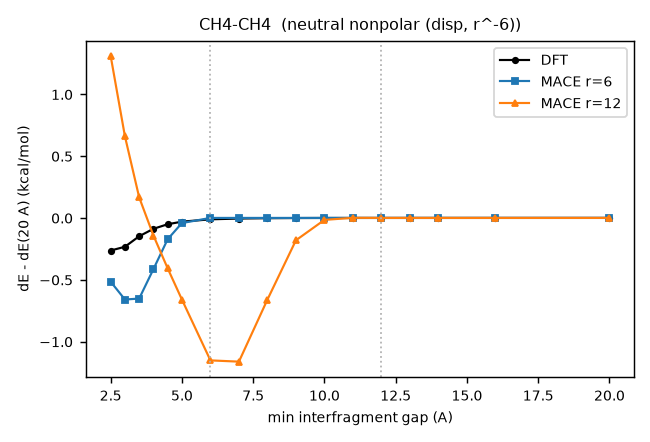

| gap (Å) | DFT | 6 Å | 12 Å | 12 Å − DFT |
|---|---|---|---|---|
| 2.50 | −0.26 | −0.52 | +1.31 | +1.57 |
| 3.00 | −0.23 | −0.66 | +0.66 | +0.89 |
| 3.50 | −0.15 | −0.65 | +0.17 | +0.31 |
| 4.00 | −0.09 | −0.41 | −0.14 | −0.05 |
| 4.50 | −0.05 | −0.17 | −0.41 | −0.36 |
| 5.00 | −0.03 | −0.04 | −0.66 | −0.63 |
| 6.00 | −0.01 | +0.00 | −1.15 | −1.14 |
| 7.00 | −0.01 | +0.00 | −1.16 | −1.16 |
| 8.00 | −0.00 | +0.00 | −0.66 | −0.66 |
| 9.00 | −0.00 | +0.00 | −0.18 | −0.18 |
| 10.00 | −0.00 | +0.00 | −0.02 | −0.02 |
| 11.00 | −0.00 | +0.00 | +0.00 | +0.00 |
| 12.00 | −0.00 | +0.00 | +0.00 | +0.00 |
| 13.00 | −0.00 | +0.00 | +0.00 | +0.00 |
| 14.00 | −0.00 | +0.00 | +0.00 | +0.00 |
| 16.00 | −0.00 | +0.00 | +0.00 | +0.00 |
| 20.00 | +0.00 | +0.00 | +0.00 | +0.00 |

### Benzene dimer, stacked (dispersion and quadrupole): 12 Å worse

The 6 Å model reproduces the 3 Å repulsion (+13.7 against DFT +11.7). The 12 Å model gets half of it (+5.3, was +1.8) and has spurious wells of −10.5 at 4 Å, −9.1 at 6 Å and −12.5 at 9 Å, gone by 11 Å. This is still the largest artifact in the set.

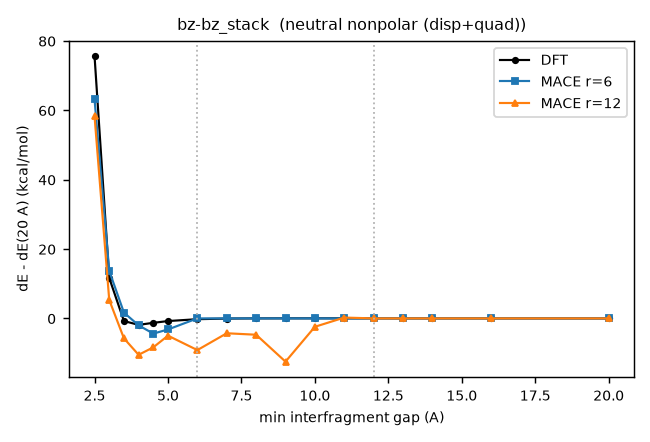

| gap (Å) | DFT | 6 Å | 12 Å | 12 Å − DFT |
|---|---|---|---|---|
| 2.50 | +75.66 | +63.16 | +58.35 | −17.31 |
| 3.00 | +11.68 | +13.70 | +5.32 | −6.35 |
| 3.50 | −0.76 | +1.67 | −5.74 | −4.98 |
| 4.00 | −1.86 | −2.00 | −10.50 | −8.64 |
| 4.50 | −1.28 | −4.39 | −8.34 | −7.06 |
| 5.00 | −0.77 | −3.19 | −4.98 | −4.21 |
| 6.00 | −0.23 | +0.00 | −9.13 | −8.91 |
| 7.00 | −0.05 | +0.00 | −4.29 | −4.24 |
| 8.00 | +0.01 | +0.00 | −4.71 | −4.72 |
| 9.00 | +0.02 | +0.00 | −12.47 | −12.49 |
| 10.00 | +0.02 | +0.00 | −2.42 | −2.44 |
| 11.00 | +0.02 | +0.00 | +0.24 | +0.22 |
| 12.00 | +0.01 | +0.00 | +0.00 | −0.01 |
| 13.00 | +0.01 | +0.00 | +0.00 | −0.01 |
| 14.00 | +0.01 | +0.00 | +0.00 | −0.01 |
| 16.00 | +0.00 | +0.00 | +0.00 | −0.00 |
| 20.00 | +0.00 | +0.00 | +0.00 | +0.00 |

Data: `longrange/scan/results_ep30/scan_table.tsv` (raw and shifted, all points), from `eval_scans.py ep30`; ORCA outputs in `longrange/scan/orca/`. Models: `runs/scratch/omol_spice20k_r{6,12}_ep30/*.cpu.model`.
