# Long-range cutoff: 6 Å vs 12 Å distance scans (PolarMACE)

This is the PolarMACE companion to `SCAN_NOTES.md` (plain MACE, 15 epochs) and `SCAN_NOTES_ep30.md` (plain MACE, 30 epochs). Two PolarMACE models were trained from scratch on the same 20k OMol25 frames as the plain MACE models (SPICE-2 elements, |q| ≤ 2, fixed ωB97M-V atom E0s, energy:force 10:10, lr 1e-3, 20 epochs). The frames were centred on their centroids (`omol25_spice20k_c`), which leaves every energy and force unchanged. The models are identical apart from the local cutoff (r_max 6 or 12 Å). Electrostatics settings are copied from the published MACE-POLAR-1 models; charge and spin enter through POLAR's charge equilibration, not embeddings.

| Model | Saved epoch | Valid RMSE_E (meV/atom) | Valid RMSE_F (meV/Å) |
|---|---|---|---|
| Plain MACE 6 Å, 30 epochs | 29 | 85.6 | 226.5 |
| Plain MACE 12 Å, 30 epochs | 29 | 75.2 | 226.0 |
| **PolarMACE 6 Å** (seed 7) | 17 | **63.5** | 234.1 |
| **PolarMACE 12 Å** (seed 123) | 18 | 68.1 | 247.2 |

The scans and the method are the ones in `SCAN_NOTES.md`: eleven fragment pairs pulled apart rigidly from 2.5 to 20 Å minimum gap, ORCA ωB97M-V/def2-TZVPD at every point, ΔE(d) = E(pair) − E(A) − E(B) in kcal/mol, each curve shifted to zero at 20 Å so only the shape is compared.

**Result.** Explicit electrostatics fixed the ion pairs and broke the ion–neutral pairs. The cation–cation repulsion now has the right sign and nearly the right size, and the attractive ion pairs follow a 1/r tail out to 20 Å at about half the DFT strength. But every ion–neutral pair (Na⁺ with water, methane and benzene; Cl⁻ with water) now repels with a slow 1/r-like tail, where DFT attracts. Both failures point the same way: the models spread a frame's total charge over all of its atoms, so part of an ion's charge sits on its partner. Energy-and-force training barely constrains where charge sits; the published POLAR-1-m (≈100M frames) gets all eleven pairs right. Within PolarMACE the 12 Å cutoff gives no consistent gain over 6 Å.

## Summary

Shifted ΔE at 3 / 8 Å, kcal/mol.

| Pair | Interaction | DFT | POLAR 6 Å | POLAR 12 Å | 12 Å vs 6 Å |
|---|---|---|---|---|---|
| NH₄⁺ · acetate | attractive ion pair, r⁻¹ | −76.51 / −21.51 | −17.88 / −3.39 | −29.11 / −8.58 | 12 Å better |
| NH₄⁺ · Cl⁻ | attractive ion pair, r⁻¹ | −74.75 / −21.22 | −35.93 / −11.84 | −39.67 / −12.52 | Same |
| NH₄⁺ · NH₄⁺ | repulsive ion pair, r⁻¹ | +51.05 / +18.00 | +54.60 / +23.57 | +45.74 / +22.20 | Same |
| Na⁺ · water | ion–dipole, r⁻² | −15.90 / −1.72 | −11.09 / −0.88 | +14.58 / +6.29 | 12 Å wrong sign |
| Cl⁻ · water | ion–dipole, r⁻² | −11.46 / −1.51 | +5.83 / +2.36 | +5.64 / +2.35 | Both wrong sign |
| Na⁺ · methane | ion–induced dipole, r⁻⁴ | −3.31 / −0.08 | +7.21 / +2.67 | +20.12 / +6.84 | Both wrong sign, 12 Å worse |
| Na⁺ · benzene | cation–π and induction | −24.17 / −1.20 | +13.45 / +6.15 | +15.20 / +11.61 | Both wrong sign |
| Water dimer, aligned dipoles | dipole–dipole, r⁻³ | −2.02 / −0.14 | −2.24 / −0.14 | −2.89 / −0.38 | 6 Å better |
| Acetonitrile dimer, head to tail | dipole–dipole, r⁻³ | −3.04 / −0.34 | −1.78 / −0.31 | −2.24 / −0.24 | Same |
| Methane dimer | dispersion, r⁻⁶ | −0.23 / −0.00 | −0.44 / −0.03 | −1.14 / −0.27 | 6 Å better |
| Benzene dimer, stacked | dispersion and quadrupole | +11.68 / +0.01 | +6.68 / −0.38 | +7.75 / −2.68 | 6 Å better |

## All models against DFT

Mean absolute error of the shifted curve over all 17 gaps, kcal/mol. POLAR-1-m is the published foundation model (6 Å local cutoff), from `scan/results_polar1/`.

| Pair | MACE 6 Å | MACE 12 Å | POLAR 6 Å | POLAR 12 Å | POLAR-1-m |
|---|---|---|---|---|---|
| NH₄⁺ · NH₄⁺ | 23.80 | 38.68 | 4.00 | 2.96 | 0.19 |
| NH₄⁺ · Cl⁻ | 29.26 | 28.96 | 14.65 | 13.60 | 1.88 |
| NH₄⁺ · acetate | 28.67 | 27.57 | 24.63 | 19.15 | 2.18 |
| Na⁺ · water | 2.07 | 0.54 | 1.22 | 12.22 | 0.33 |
| Cl⁻ · water | 2.00 | 2.38 | 6.32 | 6.55 | 0.36 |
| Na⁺ · methane | 1.14 | 0.98 | 4.13 | 9.75 | 0.37 |
| Na⁺ · benzene | 3.74 | 2.59 | 13.47 | 17.96 | 0.65 |
| Water dimer | 0.20 | 0.17 | 0.08 | 0.31 | 0.01 |
| Acetonitrile dimer | 0.26 | 1.97 | 0.34 | 0.38 | 0.03 |
| Methane dimer | 0.10 | 0.41 | 0.06 | 0.58 | 0.02 |
| Benzene dimer | 1.35 | 4.80 | 2.00 | 4.91 | 1.21 |

Raw ΔE at 20 Å (the constant offset the shifted curves remove), kcal/mol:

| Pair | DFT | MACE 6 Å | MACE 12 Å | POLAR 6 Å | POLAR 12 Å | POLAR-1-m |
|---|---|---|---|---|---|---|
| Na⁺ · water | −0.33 | +17.74 | +39.90 | +18.97 | −12.85 | −0.65 |
| Cl⁻ · water | −0.31 | −3.89 | −11.99 | −35.95 | −42.74 | −0.59 |
| Na⁺ · methane | −0.00 | +18.57 | +46.15 | +13.49 | −6.24 | −0.51 |
| Na⁺ · benzene | −0.07 | +36.50 | +77.85 | +14.83 | −0.27 | −0.80 |
| NH₄⁺ · acetate | −15.85 | −19.22 | −27.48 | −74.89 | −73.88 | −19.74 |
| NH₄⁺ · Cl⁻ | −15.80 | −31.36 | −57.06 | −84.98 | −97.53 | −19.40 |
| NH₄⁺ · NH₄⁺ | +15.06 | +16.59 | +125.53 | +21.88 | +22.25 | +15.15 |

Neutral pairs are within 0.2 kcal/mol of zero for every model.

## Why the ion–neutral pairs fail

- **Wrong-sign tails.** Na⁺ · benzene repels with a smooth tail that is still +1.3 (6 Å) and +2.0 (12 Å) kcal/mol at 16 Å. A neutral partner cannot produce a 1/r tail; a fraction of the cation's charge on the benzene can.
- **Half-strength ion pairs.** NH₄⁺ · Cl⁻ follows the right 1/r shape at about half the DFT size, as if each ion carried roughly ±0.7 instead of ±1.
- **Offsets.** The raw 20 Å offsets for the ion pairs (−75 to −98 kcal/mol against DFT −16) and for Cl⁻ · water (−36 to −43 against −0.3) are what a wrong charge partition between separated fragments gives.
- **Training signal.** The loss had energies and forces only. Nothing directly tells the charge model where charge lives, so it can put fractional charge on any atom.
- **Next lever.** The OMol25 source frames carry Löwdin and Mulliken charges and a dipole (per cafquant's notes). A dipole or charge term in the loss should pin the partition.

## Training notes

- **k-grid memory.** PolarMACE builds a k-space grid from each frame's cell even for non-periodic frames, where both electrostatics calls take the real-space path and never read it. mace sizes that cell as (max|pos|+1)·5·r_max and builds the grid for the whole batch from its largest frame. That alone asked for 55 GiB on the first launch. Centring the frames (cafquant's fix) shrinks it; the trainer and `eval_scans.py` / `frame_errors.py` also shrink the unused grid to k = 0 (`code/modal_finetune.py`).
- **6 Å instability.** The first 6 Å run (seed 123) never converged: spikes of 10–1000× in force error, also after a restart at lr 3e-4. Seed 7, same data, code and lr, converged (with transient spikes at epochs 8, 12 and 18, each recovered within one or two epochs). So the seed-123 run was a bad random draw. `frame_errors.py` on its epoch-7 state put 98% of the squared validation force error on a single 5-atom dication (HBF₂Mg, q = +2); the fragment gap was not the cause.
- **Training-set outliers.** Both final models are clean on validation but have catastrophic predictions on a few training frames (training RMSE_F 3,382 meV/Å for 12 Å and 5.1 × 10⁶ for 6 Å). Likely the same tiny charged metal frames; check before using these models on new systems.

## Plots and full tables

### Ion–ion

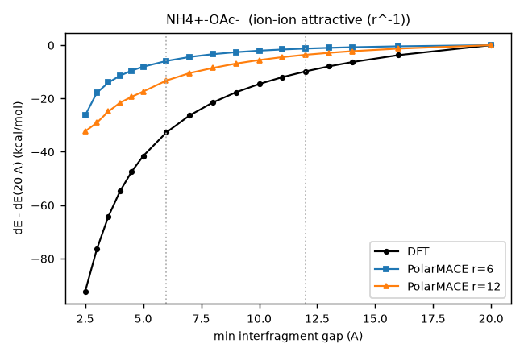

| gap (Å) | DFT | POLAR 6 Å | POLAR 12 Å | 12 Å − DFT |
|---|---|---|---|---|
| 2.50 | −92.29 | −26.32 | −32.32 | +59.97 |
| 3.00 | −76.51 | −17.88 | −29.11 | +47.40 |
| 3.50 | −64.20 | −14.02 | −24.86 | +39.34 |
| 4.00 | −54.78 | −11.47 | −21.60 | +33.18 |
| 4.50 | −47.44 | −9.55 | −19.38 | +28.06 |
| 5.00 | −41.56 | −8.10 | −17.40 | +24.17 |
| 6.00 | −32.73 | −5.94 | −13.28 | +19.45 |
| 7.00 | −26.36 | −4.44 | −10.48 | +15.88 |
| 8.00 | −21.51 | −3.39 | −8.58 | +12.93 |
| 9.00 | −17.68 | −2.64 | −6.92 | +10.76 |
| 10.00 | −14.57 | −2.07 | −5.59 | +8.99 |
| 11.00 | −12.00 | −1.63 | −4.50 | +7.50 |
| 12.00 | −9.84 | −1.28 | −3.62 | +6.22 |
| 13.00 | −7.98 | −1.00 | −2.89 | +5.10 |
| 14.00 | −6.38 | −0.78 | −2.27 | +4.11 |
| 16.00 | −3.75 | −0.43 | −1.30 | +2.45 |
| 20.00 | +0.00 | +0.00 | +0.00 | +0.00 |

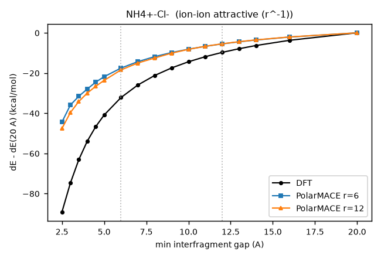

| gap (Å) | DFT | POLAR 6 Å | POLAR 12 Å | 12 Å − DFT |
|---|---|---|---|---|
| 2.50 | −89.12 | −44.39 | −47.60 | +41.52 |
| 3.00 | −74.75 | −35.93 | −39.67 | +35.07 |
| 3.50 | −63.08 | −31.56 | −34.15 | +28.93 |
| 4.00 | −53.92 | −27.98 | −30.00 | +23.93 |
| 4.50 | −46.70 | −24.54 | −26.61 | +20.09 |
| 5.00 | −40.91 | −21.84 | −23.68 | +17.23 |
| 6.00 | −32.21 | −17.55 | −18.46 | +13.75 |
| 7.00 | −25.96 | −14.34 | −15.02 | +10.94 |
| 8.00 | −21.22 | −11.84 | −12.52 | +8.69 |
| 9.00 | −17.47 | −9.82 | −10.12 | +7.35 |
| 10.00 | −14.41 | −8.14 | −8.22 | +6.19 |
| 11.00 | −11.87 | −6.72 | −6.70 | +5.18 |
| 12.00 | −9.74 | −5.51 | −5.45 | +4.29 |
| 13.00 | −7.91 | −4.48 | −4.41 | +3.50 |
| 14.00 | −6.32 | −3.58 | −3.51 | +2.81 |
| 16.00 | −3.72 | −2.10 | −2.05 | +1.66 |
| 20.00 | +0.00 | +0.00 | +0.00 | +0.00 |

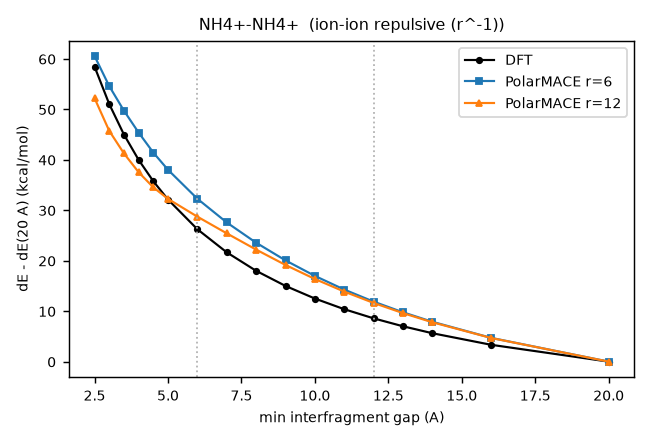

| gap (Å) | DFT | POLAR 6 Å | POLAR 12 Å | 12 Å − DFT |
|---|---|---|---|---|
| 2.50 | +58.47 | +60.57 | +52.22 | −6.25 |
| 3.00 | +51.05 | +54.60 | +45.74 | −5.31 |
| 3.50 | +45.01 | +49.74 | +41.27 | −3.74 |
| 4.00 | +39.99 | +45.40 | +37.54 | −2.45 |
| 4.50 | +35.76 | +41.43 | +34.54 | −1.21 |
| 5.00 | +32.13 | +38.02 | +32.26 | +0.13 |
| 6.00 | +26.24 | +32.28 | +28.73 | +2.49 |
| 7.00 | +21.66 | +27.58 | +25.42 | +3.76 |
| 8.00 | +18.00 | +23.57 | +22.20 | +4.20 |
| 9.00 | +15.00 | +20.06 | +19.16 | +4.15 |
| 10.00 | +12.50 | +16.99 | +16.38 | +3.87 |
| 11.00 | +10.39 | +14.28 | +13.88 | +3.49 |
| 12.00 | +8.58 | +11.89 | +11.63 | +3.05 |
| 13.00 | +7.01 | +9.77 | +9.61 | +2.61 |
| 14.00 | +5.63 | +7.89 | +7.80 | +2.17 |
| 16.00 | +3.34 | +4.71 | +4.69 | +1.35 |
| 20.00 | +0.00 | +0.00 | +0.00 | +0.00 |

### Ion–neutral

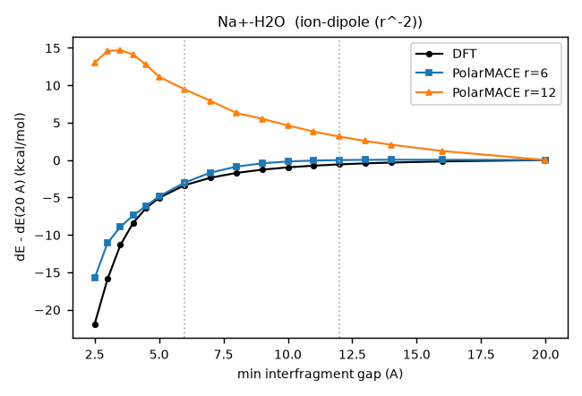

| gap (Å) | DFT | POLAR 6 Å | POLAR 12 Å | 12 Å − DFT |
|---|---|---|---|---|
| 2.50 | −21.92 | −15.79 | +12.99 | +34.91 |
| 3.00 | −15.90 | −11.09 | +14.58 | +30.48 |
| 3.50 | −11.35 | −8.93 | +14.68 | +26.04 |
| 4.00 | −8.38 | −7.39 | +14.11 | +22.48 |
| 4.50 | −6.40 | −6.13 | +12.73 | +19.13 |
| 5.00 | −5.05 | −4.86 | +11.13 | +16.18 |
| 6.00 | −3.35 | −3.00 | +9.44 | +12.80 |
| 7.00 | −2.36 | −1.68 | +7.90 | +10.26 |
| 8.00 | −1.72 | −0.88 | +6.29 | +8.01 |
| 9.00 | −1.29 | −0.43 | +5.52 | +6.81 |
| 10.00 | −0.98 | −0.19 | +4.62 | +5.60 |
| 11.00 | −0.75 | −0.07 | +3.80 | +4.55 |
| 12.00 | −0.58 | −0.01 | +3.14 | +3.71 |
| 13.00 | −0.45 | +0.03 | +2.56 | +3.00 |
| 14.00 | −0.34 | +0.04 | +2.05 | +2.39 |
| 16.00 | −0.18 | +0.04 | +1.21 | +1.39 |
| 20.00 | +0.00 | +0.00 | +0.00 | +0.00 |

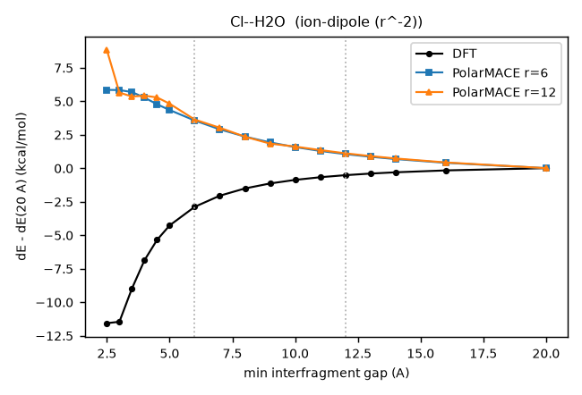

| gap (Å) | DFT | POLAR 6 Å | POLAR 12 Å | 12 Å − DFT |
|---|---|---|---|---|
| 2.50 | −11.57 | +5.84 | +8.81 | +20.39 |
| 3.00 | −11.46 | +5.83 | +5.64 | +17.11 |
| 3.50 | −8.98 | +5.68 | +5.35 | +14.33 |
| 4.00 | −6.87 | +5.26 | +5.41 | +12.28 |
| 4.50 | −5.36 | +4.77 | +5.28 | +10.63 |
| 5.00 | −4.28 | +4.34 | +4.81 | +9.09 |
| 6.00 | −2.89 | +3.56 | +3.63 | +6.51 |
| 7.00 | −2.06 | +2.90 | +3.01 | +5.07 |
| 8.00 | −1.51 | +2.36 | +2.35 | +3.86 |
| 9.00 | −1.14 | +1.92 | +1.83 | +2.98 |
| 10.00 | −0.88 | +1.57 | +1.61 | +2.49 |
| 11.00 | −0.68 | +1.29 | +1.35 | +2.03 |
| 12.00 | −0.52 | +1.05 | +1.11 | +1.63 |
| 13.00 | −0.41 | +0.85 | +0.90 | +1.31 |
| 14.00 | −0.31 | +0.68 | +0.72 | +1.03 |
| 16.00 | −0.17 | +0.40 | +0.43 | +0.59 |
| 20.00 | +0.00 | +0.00 | +0.00 | +0.00 |

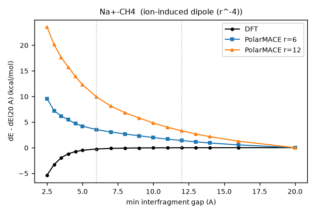

| gap (Å) | DFT | POLAR 6 Å | POLAR 12 Å | 12 Å − DFT |
|---|---|---|---|---|
| 2.50 | −5.35 | +9.58 | +23.53 | +28.88 |
| 3.00 | −3.31 | +7.21 | +20.12 | +23.43 |
| 3.50 | −1.95 | +6.18 | +17.61 | +19.56 |
| 4.00 | −1.19 | +5.44 | +15.72 | +16.91 |
| 4.50 | −0.76 | +4.71 | +13.90 | +14.66 |
| 5.00 | −0.51 | +4.21 | +12.30 | +12.80 |
| 6.00 | −0.25 | +3.52 | +9.90 | +10.15 |
| 7.00 | −0.14 | +3.06 | +8.12 | +8.26 |
| 8.00 | −0.08 | +2.67 | +6.84 | +6.92 |
| 9.00 | −0.05 | +2.31 | +5.80 | +5.86 |
| 10.00 | −0.04 | +1.98 | +4.81 | +4.85 |
| 11.00 | −0.02 | +1.67 | +3.98 | +4.01 |
| 12.00 | −0.02 | +1.39 | +3.28 | +3.30 |
| 13.00 | −0.01 | +1.14 | +2.67 | +2.69 |
| 14.00 | −0.01 | +0.91 | +2.15 | +2.15 |
| 16.00 | −0.00 | +0.54 | +1.26 | +1.27 |
| 20.00 | +0.00 | +0.00 | +0.00 | +0.00 |

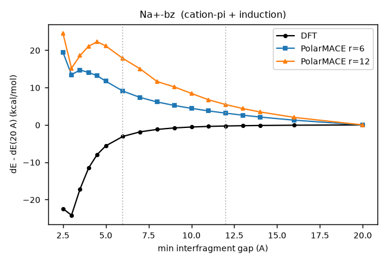

| gap (Å) | DFT | POLAR 6 Å | POLAR 12 Å | 12 Å − DFT |
|---|---|---|---|---|
| 2.50 | −22.43 | +19.46 | +24.52 | +46.95 |
| 3.00 | −24.17 | +13.45 | +15.20 | +39.37 |
| 3.50 | −17.14 | +14.72 | +18.56 | +35.70 |
| 4.00 | −11.53 | +14.04 | +21.09 | +32.62 |
| 4.50 | −7.91 | +13.17 | +22.26 | +30.17 |
| 5.00 | −5.61 | +11.71 | +21.15 | +26.76 |
| 6.00 | −3.08 | +9.06 | +17.80 | +20.89 |
| 7.00 | −1.86 | +7.36 | +15.03 | +16.89 |
| 8.00 | −1.20 | +6.15 | +11.61 | +12.81 |
| 9.00 | −0.81 | +5.21 | +10.18 | +10.99 |
| 10.00 | −0.56 | +4.43 | +8.44 | +9.00 |
| 11.00 | −0.40 | +3.75 | +6.73 | +7.13 |
| 12.00 | −0.28 | +3.15 | +5.46 | +5.74 |
| 13.00 | −0.21 | +2.60 | +4.39 | +4.59 |
| 14.00 | −0.15 | +2.11 | +3.48 | +3.63 |
| 16.00 | −0.07 | +1.27 | +2.02 | +2.09 |
| 20.00 | +0.00 | +0.00 | +0.00 | +0.00 |

### Neutral–neutral

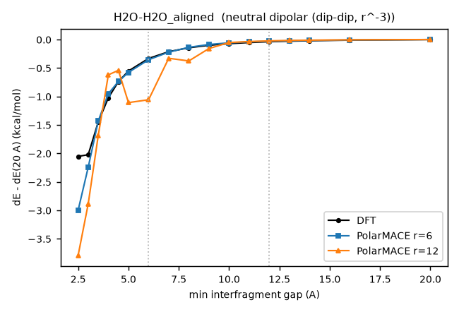

| gap (Å) | DFT | POLAR 6 Å | POLAR 12 Å | 12 Å − DFT |
|---|---|---|---|---|
| 2.50 | −2.05 | −3.00 | −3.79 | −1.74 |
| 3.00 | −2.02 | −2.24 | −2.89 | −0.86 |
| 3.50 | −1.45 | −1.43 | −1.68 | −0.23 |
| 4.00 | −1.02 | −0.95 | −0.62 | +0.40 |
| 4.50 | −0.74 | −0.74 | −0.54 | +0.20 |
| 5.00 | −0.55 | −0.58 | −1.11 | −0.56 |
| 6.00 | −0.33 | −0.35 | −1.06 | −0.72 |
| 7.00 | −0.21 | −0.22 | −0.33 | −0.12 |
| 8.00 | −0.14 | −0.14 | −0.38 | −0.23 |
| 9.00 | −0.10 | −0.09 | −0.16 | −0.06 |
| 10.00 | −0.07 | −0.06 | −0.05 | +0.02 |
| 11.00 | −0.05 | −0.04 | −0.04 | +0.02 |
| 12.00 | −0.04 | −0.03 | −0.02 | +0.01 |
| 13.00 | −0.03 | −0.02 | −0.02 | +0.01 |
| 14.00 | −0.02 | −0.02 | −0.01 | +0.01 |
| 16.00 | −0.01 | −0.01 | −0.01 | +0.01 |
| 20.00 | +0.00 | +0.00 | +0.00 | +0.00 |

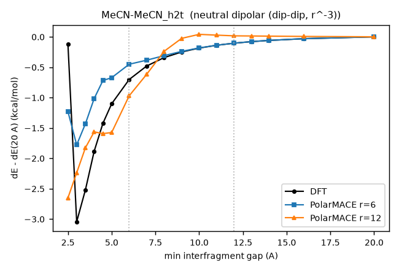

| gap (Å) | DFT | POLAR 6 Å | POLAR 12 Å | 12 Å − DFT |
|---|---|---|---|---|
| 2.50 | −0.12 | −1.23 | −2.65 | −2.53 |
| 3.00 | −3.04 | −1.78 | −2.24 | +0.81 |
| 3.50 | −2.52 | −1.43 | −1.83 | +0.69 |
| 4.00 | −1.88 | −1.02 | −1.56 | +0.32 |
| 4.50 | −1.42 | −0.72 | −1.59 | −0.17 |
| 5.00 | −1.10 | −0.67 | −1.57 | −0.47 |
| 6.00 | −0.70 | −0.45 | −0.97 | −0.27 |
| 7.00 | −0.48 | −0.39 | −0.62 | −0.14 |
| 8.00 | −0.34 | −0.31 | −0.24 | +0.10 |
| 9.00 | −0.25 | −0.24 | −0.03 | +0.22 |
| 10.00 | −0.18 | −0.18 | +0.04 | +0.23 |
| 11.00 | −0.14 | −0.14 | +0.03 | +0.17 |
| 12.00 | −0.10 | −0.10 | +0.02 | +0.12 |
| 13.00 | −0.08 | −0.08 | +0.01 | +0.09 |
| 14.00 | −0.06 | −0.06 | +0.01 | +0.07 |
| 16.00 | −0.03 | −0.03 | +0.01 | +0.04 |
| 20.00 | +0.00 | +0.00 | +0.00 | +0.00 |

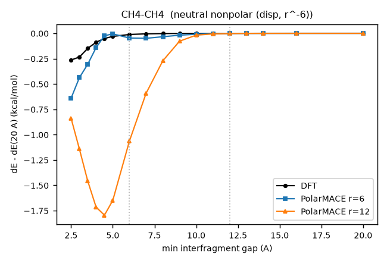

| gap (Å) | DFT | POLAR 6 Å | POLAR 12 Å | 12 Å − DFT |
|---|---|---|---|---|
| 2.50 | −0.26 | −0.64 | −0.84 | −0.57 |
| 3.00 | −0.23 | −0.44 | −1.14 | −0.91 |
| 3.50 | −0.15 | −0.30 | −1.46 | −1.31 |
| 4.00 | −0.09 | −0.14 | −1.72 | −1.63 |
| 4.50 | −0.05 | −0.02 | −1.79 | −1.74 |
| 5.00 | −0.03 | −0.01 | −1.65 | −1.62 |
| 6.00 | −0.01 | −0.05 | −1.06 | −1.05 |
| 7.00 | −0.01 | −0.05 | −0.59 | −0.58 |
| 8.00 | −0.00 | −0.03 | −0.27 | −0.27 |
| 9.00 | −0.00 | −0.02 | −0.08 | −0.08 |
| 10.00 | −0.00 | −0.01 | −0.02 | −0.02 |
| 11.00 | −0.00 | −0.00 | −0.01 | −0.01 |
| 12.00 | −0.00 | −0.00 | −0.00 | −0.00 |
| 13.00 | −0.00 | −0.00 | −0.00 | −0.00 |
| 14.00 | −0.00 | −0.00 | −0.00 | +0.00 |
| 16.00 | −0.00 | +0.00 | +0.00 | +0.00 |
| 20.00 | +0.00 | +0.00 | +0.00 | +0.00 |

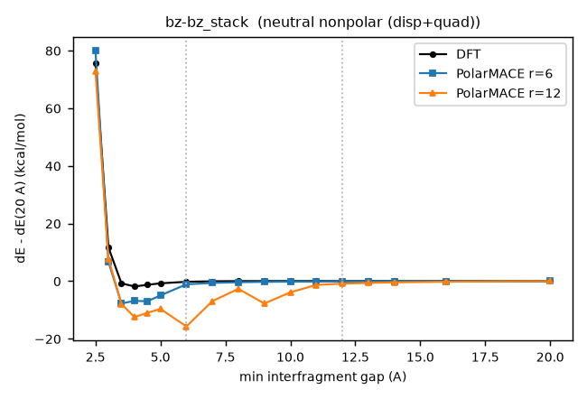

| gap (Å) | DFT | POLAR 6 Å | POLAR 12 Å | 12 Å − DFT |
|---|---|---|---|---|
| 2.50 | +75.66 | +80.01 | +72.79 | −2.86 |
| 3.00 | +11.68 | +6.68 | +7.75 | −3.93 |
| 3.50 | −0.76 | −7.76 | −7.92 | −7.15 |
| 4.00 | −1.86 | −6.85 | −12.47 | −10.61 |
| 4.50 | −1.28 | −6.99 | −11.00 | −9.72 |
| 5.00 | −0.77 | −4.96 | −9.64 | −8.87 |
| 6.00 | −0.23 | −1.11 | −15.74 | −15.51 |
| 7.00 | −0.05 | −0.63 | −6.94 | −6.89 |
| 8.00 | +0.01 | −0.38 | −2.68 | −2.69 |
| 9.00 | +0.02 | −0.26 | −7.76 | −7.78 |
| 10.00 | +0.02 | −0.19 | −3.88 | −3.91 |
| 11.00 | +0.02 | −0.14 | −1.32 | −1.34 |
| 12.00 | +0.01 | −0.11 | −0.88 | −0.90 |
| 13.00 | +0.01 | −0.09 | −0.61 | −0.62 |
| 14.00 | +0.01 | −0.07 | −0.43 | −0.43 |
| 16.00 | +0.00 | −0.04 | −0.20 | −0.20 |
| 20.00 | +0.00 | +0.00 | +0.00 | +0.00 |

Data: `longrange/scan/results_polar/scan_table.tsv`, from `eval_scans.py polar` (run with cafquant's `.venv/bin/python`, which has `graph_longrange`). Models: `runs/scratch/omol_spice20k_polar_r6_s7/` and `runs/scratch/omol_spice20k_polar_r12/` (`*.cpu.model`). Per-epoch history: `longrange/epoch_table.py --polar`.
